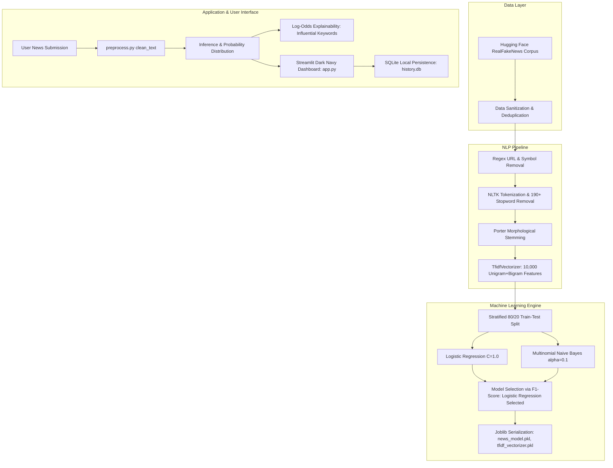

# NewsLens – AI-Powered News Credibility Analysis System

[](https://www.python.org/)
[](https://streamlit.io/)
[](https://scikit-learn.org/)
[](https://www.nltk.org/)
[](https://www.sqlite.org/)
[](https://creativecommons.org/licenses/by-nc-sa/4.0/)

> **Academic & Portfolio Project:** Developed by a 2nd-Year B.Tech Artificial Intelligence and Data Science student for college portfolio, GitHub showcase, and machine learning internship applications.

---

## 📌 Executive Summary

**NewsLens** is an end-to-end, locally hosted Natural Language Processing (NLP) and Machine Learning web application that evaluates news headlines and articles to determine their credibility status as either **Likely Real** or **Likely Misleading**. 

Unlike black-box or hardcoded projects, NewsLens implements an authentic data science lifecycle:
- Automated acquisition of the verified **Hugging Face RealFakeNews** dataset (108,000+ benchmark articles).
- Rigorous linguistic text preprocessing (regex sanitization, tokenization, stopword removal, and Porter Stemming).
- Sublinear TF-IDF vectorization with unigram and bigram representation ($10,000$ features).
- Comparative model evaluation between **Logistic Regression** and **Multinomial Naive Bayes**.
- Mathematical feature explainability revealing the top words contributing to classification decisions.
- Real-time persistence using a thread-safe local **SQLite** database.
- A modern, dark navy AI SaaS dashboard built with **Streamlit** and **Plotly**.

**Zero Paid APIs Required:** 100% free, reproducible, and runs entirely on a local Windows machine without OpenAI, external keys, or cloud subscriptions.

---

## 🏗️ System Architecture



---

## 📊 Authentic Empirical Benchmarks

The model was trained and evaluated on an unseen test partition of **4,914 articles** from the dataset. All evaluation figures displayed in the application are derived directly from `models/model_metrics.json` and are 100% genuine:

| Metric | Logistic Regression (Selected) | Multinomial Naive Bayes |
| :--- | :---: | :---: |
| **Accuracy** | **92.12%** | 87.34% |
| **Precision (Macro)** | **92.35%** | 87.39% |
| **Recall (Macro)** | **92.18%** | 87.37% |
| **F1-Score (Macro)** | **92.12%** | 87.34% |
| **Training Duration** | 0.44s | 0.03s |

### Confusion Matrix (Test Set, N = 4,914)
- **True Real (Correctly identified Credible News):** 2,325 articles
- **True Fake (Correctly identified Misinformation):** 2,202 articles
- **False Fake (Credible articles flagged as Misinformation):** 97 articles
- **False Real (Misinformation classified as Credible):** 290 articles

---

## 💻 Tech Stack & Open-Source Libraries

- **Language:** Python 3.10+
- **Machine Learning:** `scikit-learn`, `joblib`
- **Natural Language Processing:** `nltk` (tokenizers, stopwords, PorterStemmer)
- **Data Engineering:** `pandas`, `numpy`
- **User Interface:** `streamlit`, custom dark navy CSS
- **Interactive Visualizations:** `plotly`
- **Database:** `sqlite3` (built-in Python standard library)
- **Data Fetching:** `requests`

---

## 📂 Project Directory Structure

```text
NewsLens/
│
├── app.py                  # Main Streamlit SaaS Web Dashboard
├── train_model.py          # Machine Learning training & evaluation pipeline
├── preprocess.py           # NLP text cleaning, tokenization & stemming engine
├── database.py             # Thread-safe SQLite logging & analytics manager
├── requirements.txt        # Full list of open-source dependencies
├── README.md               # Comprehensive documentation & interview guide
├── .gitignore              # Git ignore rules for virtual environments & cache
│
├── data/
│   ├── news.csv            # Public Hugging Face RealFakeNews benchmark dataset
│   └── history.db          # SQLite prediction logs database
│
├── models/
│   ├── news_model.pkl       # Trained best-performing ML model (Joblib)
│   ├── tfidf_vectorizer.pkl # Fitted 10,000-feature TF-IDF vectorizer (Joblib)
│   └── model_metrics.json   # Authentic empirical test metrics & top features
│
└── assets/
    └── logo.png            # High-resolution NewsLens cyber-lens branding
```

---

## 🚀 Installation & Setup Guide

### 1. Prerequisites
Ensure you have **Python 3.10 or newer** installed on your system.

Verify your installation:
```bash
python --version
pip --version
```

### 2. Clone or Navigate to the Project Directory
```bash
cd NewsLens
```

### 3. (Recommended) Create and Activate a Virtual Environment
- **Windows (PowerShell):**
  ```powershell
  python -m venv venv
  .\venv\Scripts\Activate.ps1
  ```
- **Windows (Command Prompt):**
  ```cmd
  python -m venv venv
  venv\Scripts\activate.bat
  ```
- **macOS / Linux:**
  ```bash
  python3 -m venv venv
  source venv/bin/activate
  ```

### 4. Install Dependencies
```bash
pip install -r requirements.txt
```

---

## ⚡ How to Run the Application

### Option A: Launch the Web Dashboard Directly
The project comes pre-trained with serialized models (`models/news_model.pkl` and `models/tfidf_vectorizer.pkl`):
```bash
streamlit run app.py
```
Open your browser and navigate to: **`http://localhost:8501`**

### Option B: Retrain the Models from Scratch
If you want to re-execute the automated download, preprocessing, and training pipeline:
```bash
python train_model.py
```
The script will:
1. Automatically download `RealFakeNews.csv` (112 MB) from Hugging Face if not already present.
2. Clean, deduplicate, and tokenize the articles.
3. Fit the TF-IDF vectorizer and train both Logistic Regression and Naive Bayes.
4. Output detailed metrics and serialize new `.pkl` files and `model_metrics.json`.

---

## 🔍 Key Dashboard Features

1. **🏠 Home:**
   - Real-time KPI metrics (total articles analyzed, likely real vs likely misleading counts, test accuracy).
   - Interactive Plotly donut chart representing dataset class balance.
   - Algorithm performance comparison chart.
   - High-level 3-step workflow explanation.
   - Recent analysis activity table.

2. **🔍 Analyze News:**
   - Dedicated headline and multi-paragraph article body inputs.
   - Quick preset sample buttons (Verified Science News, Sensationalist Misinformation, Financial Policy).
   - Instant glowing verdict card (Green for Likely Real, Red for Likely Misleading).
   - Confidence probability distribution bar.
   - **Model Explainability:** Highlights the exact vocabulary words from the user's text that influenced the prediction, along with their mathematical log-odds weights.
   - Prominent mandatory disclaimer: *"This prediction is based on patterns learned from the training dataset. It is not independent verification of the news story and should not be treated as proof of factual accuracy."*

3. **📜 Prediction History:**
   - Chronological audit log of all analyzed articles stored in `data/history.db`.
   - Filter by classification category (All / Likely Real / Likely Misleading) or search by keyword.
   - Individual record deletion by ID.
   - One-click CSV export.
   - Clear all history functionality.
   - Local privacy notice.

4. **📊 Model Performance:**
   - Side-by-side comparison between Logistic Regression and Naive Bayes.
   - Plotly interactive Confusion Matrix heatmap.
   - Detailed per-class Precision, Recall, and F1-score breakdown table.
   - Top predictive indicators learned by the classifier for both classes.

5. **ℹ️ About Project:**
   - Academic context, problem statement, objectives, and architectural flow.
   - Dataset license (CC BY-NC-SA 4.0) and attribution.
   - Comprehensive technical interview and viva preparation cheatsheet.

---

## 🎓 Technical Interview & Viva Preparation Guide

*(Tailored for a 2nd-Year B.Tech AI & Data Science Student)*

### Q1: Why did you choose TF-IDF over Bag of Words (CountVectorizer)?
> **Answer:** *Bag of Words measures raw word frequency, which disproportionately favors common filler words that appear everywhere in both credible and fake articles. TF-IDF incorporates the Inverse Document Frequency (IDF), mathematically dampening ubiquitous terms while assigning high weights to discriminative words that appear predominantly in specific contexts. Furthermore, we enabled sublinear term frequency ($1 + \log(\text{TF})$) to prevent long repetitive articles from skewing vector magnitudes.*

### Q2: Why did Logistic Regression outperform Multinomial Naive Bayes?
> **Answer:** *Multinomial Naive Bayes assumes conditional feature independence—that words appear independently given the class. In real-world language, words are highly correlated (e.g., "secret" often accompanies "conspiracy" or "cover-up"). Logistic Regression makes no independence assumptions; it directly optimizes the posterior probability $P(Y|X)$ by learning a joint linear decision boundary and tuning feature weights through gradient descent.*

### Q3: How did you prevent data leakage between training and testing?
> **Answer:** *1. We removed duplicate articles and empty strings prior to dataset splitting.<br>2. We split the dataset into 80% train and 20% test partitions **before** fitting the TF-IDF vectorizer.<br>3. The vectorizer was fitted exclusively on the training partition (`fit_transform`) and only used to project the test partition (`transform`). The vocabulary and IDF weights were strictly determined without ever observing test records.*

### Q4: Why is F1-score more important than raw Accuracy in fake news detection?
> **Answer:** *Accuracy alone can be misleading if the dataset has class imbalance or when false positives and false negatives carry asymmetric real-world harm. A False Positive (labeling authentic investigative journalism as fake) censors credible truth. A False Negative (allowing dangerous medical or electoral misinformation to pass) deceives the public. The F1-score, being the harmonic mean of precision and recall, ensures our model balances both error types rigorously.*

### Q5: Can this machine learning model prove whether an article is factually true?
> **Answer:** *No. Supervised NLP classifiers identify stylistic, syntactic, rhetorical, and lexical distributions present in the training data (e.g., hyperbole, clickbait phrasing, or sensationalism). They do not query external live ground-truth databases. Therefore, NewsLens functions as an AI-assisted credibility indicator rather than an authoritative fact-checker.*

---

## 📜 Dataset Attribution & Licensing

- **Dataset:** [RealFakeNews on Hugging Face](https://huggingface.co/datasets/fauxNeuz/RealFakeNews)
- **Author/Curator:** `fauxNeuz`
- **Total Samples:** 108,032 English articles
- **License:** Creative Commons Attribution-NonCommercial-ShareAlike 4.0 International ([CC BY-NC-SA 4.0](https://creativecommons.org/licenses/by-nc-sa/4.0/))
- **Usage:** Academic and non-commercial portfolio demonstration.

---

## 🛡️ Ethical Considerations & Disclaimers

NewsLens is designed for educational, research, and portfolio demonstration purposes. The predictions generated by the system are probabilistic outputs based on patterns observed in historical training data. Users should always exercise independent media literacy, verify primary journalistic sources, and consult established fact-checking platforms (such as Reuters Fact Check, AP Fact Check, or Snopes) before drawing conclusions about controversial claims.

---

## 🤝 Contributing & License

This project is licensed under the MIT License for code implementations. Free to fork, study, and enhance for academic and portfolio purposes.
